# 📒 Logboek

Wat Claude zelfstandig gebouwd heeft, per stap.
Per stap: ✅ wat klaar is · 🖼️ plaatjes · 🔍 wat getest is (en wat niet) · ❓ vragen en keuzes voor Odelia.

De plaatjes staan in de map `logboek/`. Ze komen uit het voorproef-hulpje (computer-versie van de schermen), **niet** van een echte telefoon.

---

## 0. Feedback op stap 1 (24 okt)

✅ **Klaar**
- 📋 Zijbalk: tik op een icoontje = meteen erheen. Alleen het oranje knopje maakt hem breed.
- ✨ Tik-effect: geen vlek meer. Knop wordt heel even iets kleiner.
- 🎨 Icoontjes: Geld = munt met €. "Komt later" = rond klei-knopje. 9 scheve icoontjes rechtgezet.
- 🗑️ Wachtwoorden weg.

🔍 **Getest**
- ✅ Compileert (voorproef met Compose 1.7.3).
- ✅ **Echte Android-app gebouwd in de cloud** (`app-debug.apk`). Dat lukte nu voor het eerst: `dl.google.com` werkt sinds vandaag.
- ❌ Niet op een telefoon getest. Een emulator kan hier niet draaien.

❓ **Voor jou**
- Niets.

🖼️ **Plaatjes** (links voor, rechts na)


---

## 2. ⏱️ In- en uitklokken

### 2a + 2b: echt klokken, overzicht, dag aanpassen

✅ **Klaar**
- 💾 De knop bewaart nu echt. Opslag met Room, alleen op de telefoon. Elke regel heeft een UUID en `updated_at` (klaar voor later synchroniseren).
- 🟢 Groen = aan het werk: "sinds 7:45" en "al 5½ uur gewerkt" (loopt mee, elke 30 sec).
- 🌸 Roze = klaar: "Klaar voor vandaag", uren na de pauze, "uitgeklokt om 15:50".
- 🧮 Pauze: altijd 45 min eraf (nooit onder 0). Twee keer klokken op één dag mag; de pauze gaat er maar één keer af.
- 📊 Tegels Vandaag/Deze week en het Werk-tabje (ring + staafjes) tonen echte uren.
- ✏️ Tik op een dag (tegel, legenda of staafje) → dag aanpassen:
  - 💼 gewerkt / 🌿 vrij / 🤒 ziek
  - begin- en eindtijd met knoppen −1 u, −5, +5, +1 u
  - "Nog een blok" en "Blok weghalen" (twee keer tikken, zodat het niet per ongeluk gaat)
- ⏰ Vergeten uit te klokken? Dan verschijnt een geel kaartje met de knop "om 15:45" of "andere tijd".
- 🎯 Weekdoel: tik op "doel 35 u" in het Werk-tabje en pas het aan met − en +.

🖼️ **Plaatjes**

| Aan het werk | Klaar | Vergeten |
|---|---|---|
|  |  |  |

| Werk-tabje | Dag aanpassen |
|---|---|
|  |  |

🔍 **Getest**
- ✅ Echte Android-app gebouwd.
- ✅ 9 tests voor de urenberekening (pauze, twee blokken, vrij/ziek, vergeten, weekend) slagen.
- ✅ Plaatjes bekeken en vergeleken met het ontwerp.
- ❌ Niet op de telefoon getest: opslaan, de klok die meeloopt en het knoppen-gevoel.
- ⚠️ Emoji (💼 🌿 🤒) zien er op de plaatjes zwart-wit uit. Op de telefoon zijn ze in kleur.

❓ **Keuzes die ik gemaakt heb** (zeg het als je het anders wilt)
- 🔢 Tijdens het werk: "Vandaag" = tijd sinds inklokken (zoals in het ontwerp). Na het uitklokken: uren mét de pauze eraf.
- 🌿 Vrije en zieke dagen tellen als 0 uur. Ze tellen niet mee voor je 35 uur. ✅ *Beantwoord: klopt, maar zet ze erbij (zie stap 6).*
- ⏰ Bij "vergeten uit te klokken" stelt de app 15:45 voor.

### 2c: widget op het startscherm 🏠

✅ **Klaar**
- Widget "Klokken" (4 × 2 vakjes), zoals in het ontwerp:
  - links de grote knop: groen = aan het werk, roze = niet. **Tik = in- of uitklokken.**
  - rechts de ring met je uren van deze week. Tik = app openen.
- De widget ververst meteen na elke klik (in de app, in de widget of in een melding) en verder elk half uur.
- 📲 Zo zet je hem erop: lang drukken op het startscherm › Widgets › "Mijn dashboard" › "Klokken".

🖼️ **Plaatjes** (getekend met Robolectric, geen echte telefoon)

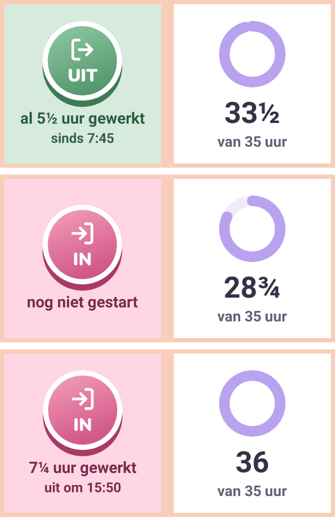

🔍 **Getest**
- ✅ Gebouwd, en 3 plaatjes gemaakt van de widget (aan het werk, nog niet gestart, klaar).
- ❌ Niet op de telefoon getest: of de klik werkt en hoe hij er in jouw launcher uitziet.
- ⚠️ Op de plaatjes zijn de hoekjes niet rond. Op Android 12+ zijn ze dat wel, maar dat kan Robolectric niet tekenen.
- ⚠️ Een widget kan geen eigen lettertype gebruiken. De tekst is dus de gewone telefoonletter, niet Nunito. "UIT"/"IN" op de knop is wel Nunito, want dat is een plaatje.
- ⚠️ "al 5½ uur gewerkt" in de widget kan tot een half uur achterlopen. Android laat een widget niet vaker verversen.

### 2d: herinneringen 🔔

✅ **Klaar**
- ma–vr **8:15**: nog niet ingeklokt? → melding met knoppen **Inklokken · Vandaag vrij · Ziek**.
- ma–vr **16:15**: nog ingeklokt? → melding met knoppen **Uitklokken · Over 10 min · Over 20 min** (jouw snooze-wens).
- Op een vrije of zieke dag komt er geen inklok-melding.
- Klok je in de app in of uit, dan verdwijnt een melding die niet meer klopt vanzelf.
- Na het opnieuw opstarten van de telefoon zet de app de herinneringen weer klaar.
- De eerste keer vraagt Android of de app meldingen mag sturen. Zeg **"Toestaan"**.

🔍 **Getest**
- ✅ 4 tests voor de planning, bijvoorbeeld vrijdagavond → maandag 8:15 en weekend → maandag.
- ✅ 3 Robolectric-tests: de melding heeft de 3 knoppen, zonder toestemming komt er geen melding, en de wekkers staan op 8:15 en 16:15.
- ✅ Android-lint: 0 fouten.
- ❌ Niet op de telefoon getest.
- ⚠️ Android mag een herinnering een paar minuten later laten komen, om de batterij te sparen. Precies op de minuut kan alleen met een extra toestemming ("Wekkers"). Die heb ik expres niet gevraagd.

❓ **Voor jou**
- 🔕 Komen de meldingen niet? Kijk dan bij Instellingen › Apps › Mijn dashboard › Meldingen. Op de Nothing Phone ook bij Batterij › "Niet beperken".

---

## 3. 🧠 Onthoud

✅ **Klaar**
- ✍️ **Onthoud dit** (zoals ontwerp/Toevoegen): wat · soort · wie · waar hoort het bij · wanneer klaar · notitie · seintje.
  - Alleen "wat" is nodig. De rest mag leeg blijven (vrij, geen strak lijstje).
  - 🎤 **Inspreken**: de grote koraal knop rechtsboven. Dat gebruikt de spraakherkenning van je telefoon (Nederlands).
  - 📋 **Plakken**: zet de tekst van het klembord erin.
  - 👤 Nieuwe persoon toevoegen met **+** (naam + School/Werk/Thuis).
  - 📁 Projecten (zoals PVB, keuzedeel) maak je zelf aan met **+ project**.
- 🏠 **Onthoud-tabje**: de eerstvolgende 5 afspraken, met de knoppen **Iets onthouden** en 🎤.
- 📋 **Alles**: zoekbalk (ook met 🎤), filters per groep en per project, en een indeling in te laat / vandaag / morgen / deze week / later / geen datum. Afvinken met het rondje.
- 📊 **Samenvatting per onderwerp**: kies een project of groep. Je ziet dan hoeveel er nog moet, hoeveel klaar is, en wat het eerst moet. Met 🔊 voorlezen.
- 👥 **Mensen** (zoals ontwerp/Mensen): School/Werk/Thuis, rondjes per persoon, "Wat hebben we afgesproken?", aantal "nog doen", + Afspraak, 🔊 voorlezen.
- 🔎 Zoeken kijkt naar alles: wat, notitie, naam, rol, project, groep en soort. Hoofdletters en accenten maken niet uit.
- 🔔 **Seintje de dag ervoor** (later aangepast: zit nu in het ochtendbericht, zie stap 6).
- 📤 **Delen**: in WhatsApp, Gmail enz. kies je "Delen" › **Onthoud dit**. De tekst staat dan meteen klaar.
- 🧩 **Widget "Onthoud"**: knop "+ Iets onthouden" en 🎤 (meteen inspreken).
- 💾 Opslag: personen en afspraken in Room, elk met een UUID en `updated_at`. Je uren uit stap 2 blijven gewoon staan (database-versie 2).

🖼️ **Plaatjes** (met verzonnen voorbeelden uit het ontwerp)

| Onthoud-tabje | Onthoud dit | Aanpassen |
|---|---|---|
| 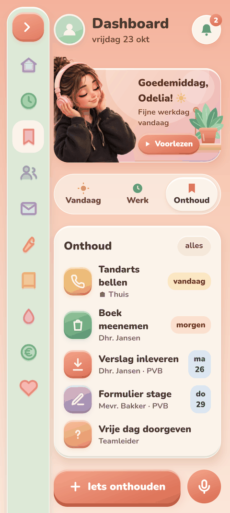 | 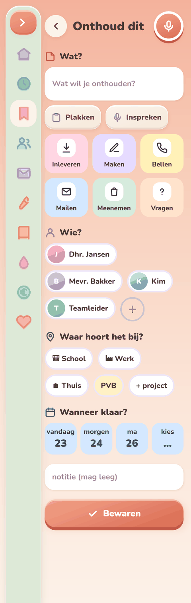 | 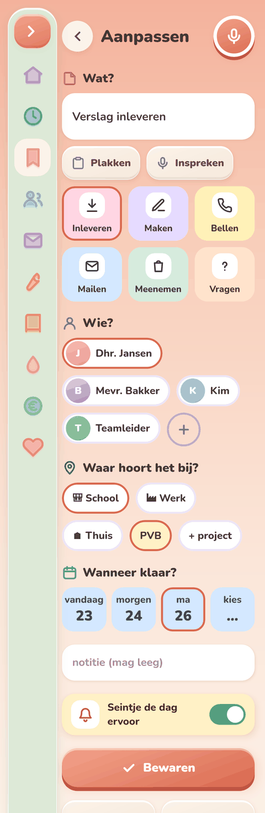 |

| Alles | Project PVB | Mensen |
|---|---|---|
| 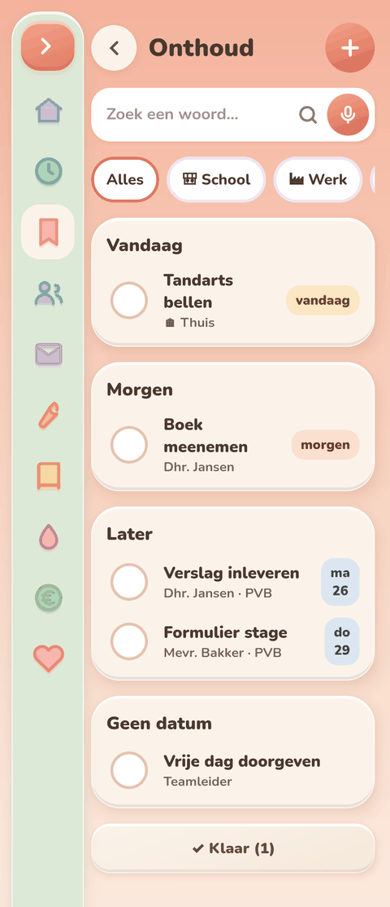 | 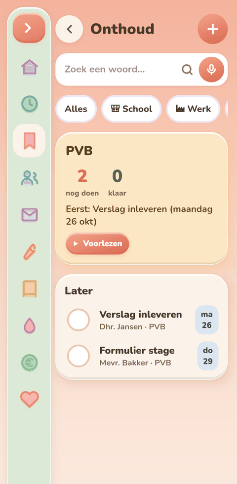 | 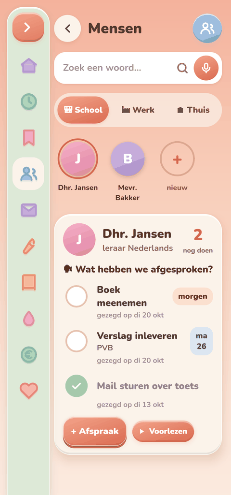 |

Widget: 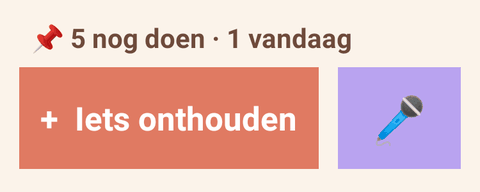

🔍 **Getest**
- ✅ Echte Android-app gebouwd. Lint: 0 fouten.
- ✅ 9 tests voor zoeken, indelen, samenvatting en seintje.
- ✅ 3 tests die echt opslaan in de database en weer teruglezen (klokken, vrij/ziek, afspraak met persoon, afvinken, weghalen).
- ✅ Een test voor de melding "Morgen: Boek meenemen (Dhr. Jansen)".
- ✅ Plaatjes bekeken en vergeleken met het ontwerp.
- ❌ Niet op de telefoon getest: inspreken, delen vanuit andere apps, plakken, de widget-knoppen en de meldingen.
- ⚠️ Inspreken gebruikt de spraakherkenning van Google op je telefoon. Zonder internet werkt het misschien niet, tenzij Nederlands offline is gedownload.

❓ **Keuzes die ik gemaakt heb** (zeg het als je het anders wilt)
- ⏰ Het seintje komt om 16:30 de dag ervoor. ✅ *Beantwoord: in het ochtendbericht, met "vanavond nog een keer" (zie stap 6).*
- 📍 "Waar" heeft geen eigen vakje. Typ het in de tekst of in de notitie. Wil je toch een apart vakje?
- 👥 Personen kun je toevoegen, maar nog niet aanpassen of weghalen. Komt later, als je dat wilt.
- 🏷️ De groepen zijn vast: 🎒 School, 🏭 Werk, 🏠 Thuis. Projecten maak je zelf.

---

## 4. 🔔 Ochtendmelding

✅ **Klaar**
- ☀️ **20 minuten na je eerste inklokken** van de dag komt er een melding met wat er vandaag en deze week staat. Voorbeeld:

  > **Goedemorgen! ☀️ Vandaag: Tandarts bellen**
  > Vandaag:
  > • Tandarts bellen
  >
  > Deze week:
  > • Boek meenemen – Dhr. Jansen (morgen)

- Op **vrijdag** staat er ook: "📧 Vandaag na het werk: urenmail voor Kim klaarzetten."
- Klok je later op de dag nog een keer in (bijvoorbeeld na de lunch)? Dan komt er geen tweede ochtendmelding.
- 🔔 De **bel** rechtsboven op het hoofdscherm telt nu echt: hoeveel er vandaag (of te laat) moet. Tik = de lijst. Staat er niets, dan is er geen rood bolletje.
- 🔊 **Voorlezen** op de welkomkaart noemt nu ook wat er vandaag staat.

🔍 **Getest**
- ✅ 4 tests voor de tekst van de melding (vandaag, deze week, niets, vrijdag) en het voorlezen.
- ✅ Een test dat inklokken om 7:45 een wekker zet om 8:05.
- ✅ Echte Android-app gebouwd.
- ❌ Niet op de telefoon getest. Ik kon geen plaatje van de melding maken, want meldingen tekent Android zelf. Daarom staat hierboven de tekst.

❓ **Voor jou**
- Niets nieuws.

---

## 5. 📧 Urenmail voor Kim

✅ **Klaar**
- 🔒 **De app verstuurt nooit zelf een mail.** Hij zet alleen een concept klaar.
- 📧 Scherm **Urenmail**: tik op de tegel "Mail Kim" op het hoofdscherm.
  - kies **vorige week** of **deze week** (vanaf donderdag staat "deze week" klaar)
  - vul één keer het e-mailadres van Kim in (blijft alleen op je telefoon)
  - schrijf eventueel een **opmerking** (komt onder "Hier de uren van afgelopen week.")
  - je ziet de brief, met daaronder de uren als **tabel**: datum · begin · eind · uren. "vrij" en "ziek" staan er als tekst.
- ✉️ **Open in Gmail**: Gmail opent met onderwerp "Urenregistratie" en de tekst erin. Jij drukt zelf op verzenden.
- 📋 **Kopiëren**: om in de bestaande mail "Urenregistratie" op **Beantwoorden** te tikken en te plakken.
- 📤 **Delen** via het Android-menu.
- 🔔 **Vrijdag, 30 minuten na het uitklokken**: melding "Urenmail voor Kim staat klaar". Tik erop en het scherm opent. Klok je daarna toch weer in? Dan schuift de melding mee met je nieuwe uitkloktijd.
- 📄 In **GMAIL-KOPPELING.md** staat wat je later moet instellen voor de échte koppeling. Dan zet de app het concept zelf in de draad, met een echte tabel.

🖼️ **Plaatjes**

| Urenmail | Tegel "Mail Kim" |
|---|---|
| 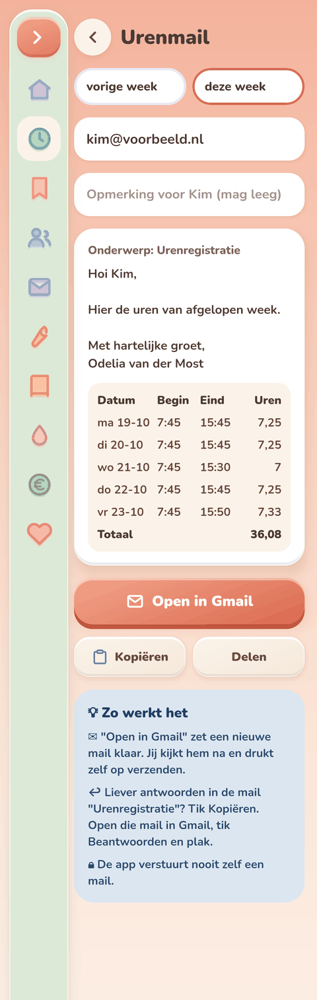 |  |

In de mail zelf ziet het overzicht er zo uit (gewone regels, want een tabel kan Gmail op deze manier niet maken):

```
ma 19-10-2026: 7:45 – 15:45 = 7:15 uur
di 20-10-2026: 7:30 – 16:00 = 7:45 uur
wo 21-10-2026: vrij
do 22-10-2026: ziek
vr 23-10-2026: 7:45 – 15:50 = 7:20 uur
Totaal: 22:20 uur · 1 dag vrij · 1 dag ziek
```

🔍 **Getest**
- ✅ 6 tests voor de mail: de tekst precies zoals in CLAUDE.md, vrij/ziek, opmerking, komma-getallen, welke week, en "staat klaar".
- ✅ Een test dat uitklokken op vrijdag om 15:00 een wekker zet om 15:30.
- ✅ Echte Android-app gebouwd.
- ❌ Niet op de telefoon getest: of Gmail opent met alles ingevuld. De meeste Gmail-versies doen dat. Gebeurt het niet, gebruik dan Kopiëren.

❓ **Vragen voor jou**
- 🔢 Uren als 7,25 of 7:15? ✅ *Beantwoord: 7:15 (zie stap 6).*
- 📅 Datum "19-10-2026" of "maandag 19 oktober"? ✅ *Beantwoord: 19-10-2026.*
- 📧 Moet er nog iets anders in de mail, bijvoorbeeld je personeelsnummer?

---

## 📦 Afronding

- ✅ Alles staat in **één PR** (dezelfde PR als de feedback). Niet zelf gemerged.
- ✅ **APK** gebouwd: `Mijn dashboard` versie **0.2**. Claude heeft hem in de chat gestuurd.
- 🔒 De app vraagt **geen internet-toestemming**. Je uren en afspraken blijven op je telefoon.
- 🧪 In totaal **43 tests**, allemaal geslaagd. Android-lint: 0 fouten.
- ⚠️ **Niets is op een echte telefoon getest.** Graag alles één keer proberen: klokken, widget, meldingen, inspreken, delen, Gmail.

⚠️ **Installeren:** staat de app er al op via Android Studio? Verwijder hem dan eerst. Anders zegt Android "App niet geïnstalleerd", omdat de sleutel anders is. Er gaan geen echte gegevens verloren: stap 1 had alleen voorbeeld-getallen.
Kies daarna één manier en blijf daarbij (Android Studio óf de APK van Claude). Anders moet je bij elke wissel opnieuw verwijderen, en dan ben je je gegevens kwijt.

---

## 6. ✏️ Jouw antwoorden verwerkt (24 okt, versie 0.3)

✅ **Klaar**
- 🔢 **Urenmail: uren als 7:15** (uren:minuten), ook in de tabel en bij het totaal.
- 🌿 **Vrij en ziek staan er nu bij**, maar tellen niet mee voor je 35 uur:
  - Werk-tabje: "29 uur gewerkt · 1 dag ziek"
  - tegel "Deze week": "van 35 uur + 1 dag ziek"
  - urenmail: "Totaal: 29:05 uur · 1 dag ziek"
- 🔔 **Seintje voor morgen zit in je ochtendbericht** (20 min na inklokken), onder "📌 Morgen".
  - Met de knop **"Vanavond nog een keer"**. Tik erop, dan komt het seintje om **19:00** terug. Het ochtendbericht laat dan zien: "🌙 Vanavond om 19:00 krijg je het nog een keer."
  - Klok je die dag niet in (weekend, vrij, ziek)? Dan komt het ochtendbericht om **10:00**, maar alleen als er iets voor morgen staat. Zo mis je het niet.
  - Het oude seintje van 16:30 is weg.
- 📅 Datum in de mail blijft **19-10-2026**.

🖼️ **Plaatjes** (voorbeeld met een zieke woensdag)

| Werk-tabje | Urenmail |
|---|---|
| 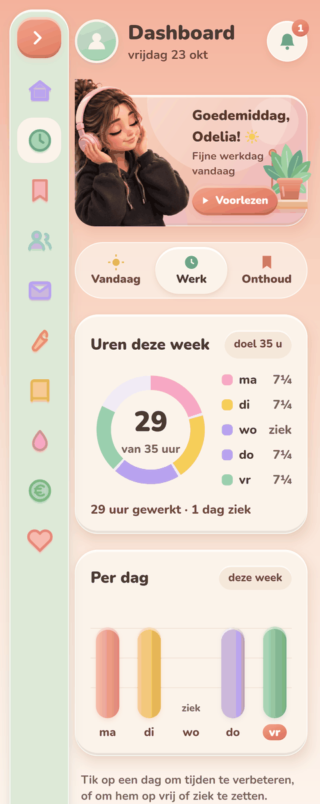 |  |

🔍 **Getest**
- ✅ Echte Android-app gebouwd (versie 0.3).
- ✅ 46 tests slagen. Nieuw: uren als 7:15, vrij/ziek-tekst, "📌 Morgen" in het ochtendbericht, de knop "Vanavond nog een keer" en de wekker om 19:00, en de reserve om 10:00.
- ❌ Nog steeds niet op de telefoon getest.

❓ **Voor jou**
- ✅ ~~Is **10:00** goed voor dagen zonder inklokken?~~ Ja, 10:00 is goed (Odelia, 24 okt).

---

## 7. 📝 Jouw briefje verwerkt (24 okt, avond, versie 0.4)

✅ **Klaar**
- 🗑️ **Tegels onderaan weg** (Advies, Mail-hulp, Mensen, Week, Wensen). Ze staan al in de zijbalk. Week = het Werk-tabje.
- ✏️ **Mensen aanpassen**: op de kaart van een persoon staat de knop **"Persoon aanpassen"**. Je kunt de naam, de beschrijving en de groep veranderen.
- 🗑️ **Mensen weghalen**: in hetzelfde scherm staat **"Persoon weghalen"**. Eerst vraagt de app: "Weet je het zeker? Tik nog een keer".
  - De afspraken blijven staan, maar zonder naam.
  - Ze blijven bij dezelfde groep (School, Werk of Thuis), zodat je ze terugvindt.
- ✅ **To-do**: bij "Onthoud dit" kies je bovenaan **📅 Afspraak** of **✅ To-do**.
  - In de lijst kies je bovenaan: **Alles · Afspraken · To-do**.
  - Onder een to-do staat "✓ To-do".
  - Zoeken op "todo" werkt ook.
- ✂️ "Enter-knop bij Onthoud dit" was doorgestreept: niets aan gedaan.
- ⏱️ "Uren": volgens jou hoeft er niets te gebeuren.

🖼️ **Plaatjes**

| Werk-tabje zonder tegels | Persoon aanpassen |
|---|---|
| 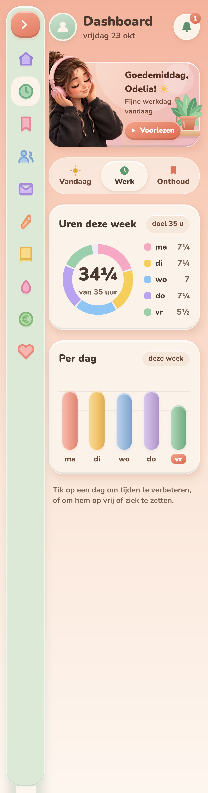 | 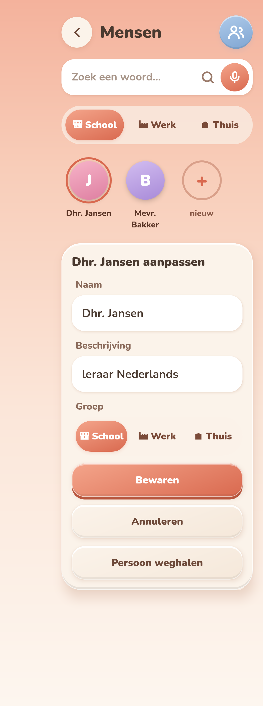 |

| Onthoud dit: Afspraak of To-do | Lijst: alleen to-do's |
|---|---|
| 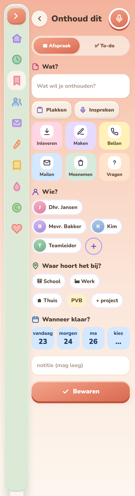 | 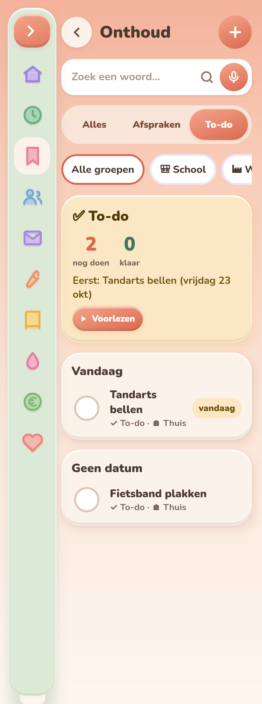 |

🔍 **Getest**
- ✅ Echte Android-app gebouwd (versie 0.4). Dezelfde sleutel als 0.2 en 0.3: je kunt hem eroverheen zetten.
- ✅ 49 tests slagen. Nieuw:
  - persoon aanpassen en weghalen in de echte database
  - zoeken op to-do
  - **update-test**: een database van versie 0.3 met (verzonnen) uren, mensen en afspraken. Na de update staat alles er nog.
- ✅ Android-lint: 0 fouten.
- ❌ Nog steeds niet op de telefoon getest.

❓ **Voor jou**
- ✅ 10:00 voor dagen zonder inklokken is goed (Odelia, 24 okt). Er staan nu geen open vragen meer.

---

## 8. ∞ Geen einddatum (24 okt, avond, versie 0.5)

✅ **Klaar**
- Bij "Wanneer klaar?" staat nu een vijfde vakje: **"geen ∞"**.
- Bij iets nieuws staat het meteen aan (koraal randje).
- Tik je op een dag, dan gaat "geen" uit. Tik je op "geen", dan is de dag weer weg.
- In de lijst staan deze dingen onder "Geen datum".

🖼️ **Plaatje**

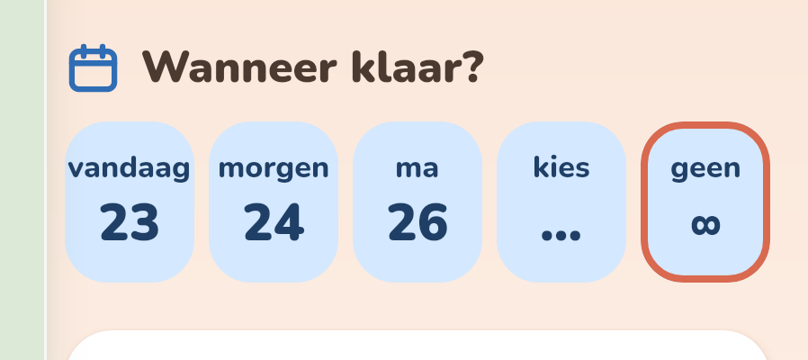

🔍 **Getest**
- ✅ Echte Android-app gebouwd (versie 0.5, dezelfde sleutel).
- ✅ 49 tests slagen. Android-lint: 0 fouten.
- ❌ Niet op de telefoon getest.

---

## 9. 💡 Tips in het ochtendbericht (24 okt, avond, versie 0.6)

✅ **Klaar**
- ⏳ Bij "Onthoud dit" een nieuwe vraag: **"Hoe lang duurt het?"**
  - 15 min · 1 uur · paar uur · 1 dag · 1 week · paar maanden. Mag leeg blijven.
  - In de lijst staat het eronder, bijvoorbeeld "✓ To-do · 15 min · 🏠 Thuis".
- 💡 **Tips in het ochtendbericht** als er tijd over is (max 3):
  - eerst dingen met een datum na deze week (zodat je je kunt voorbereiden)
  - dan dingen zonder datum, de oudste eerst
  - iets van een dag of langer: "Begin alvast: …"
- 📋 Onderaan: "Nog 3 dingen zonder datum." Zo vergeet je ze niet.

Voorbeeld:
```
💡 Rustige dag. Je kunt dit al doen:
• Begin alvast: Verslag schrijven – Dhr. Jansen (ma 2 nov · 1 week)
• Kast opruimen (1 uur)

📋 Nog 3 dingen zonder datum.
```

🖼️ **Plaatje**

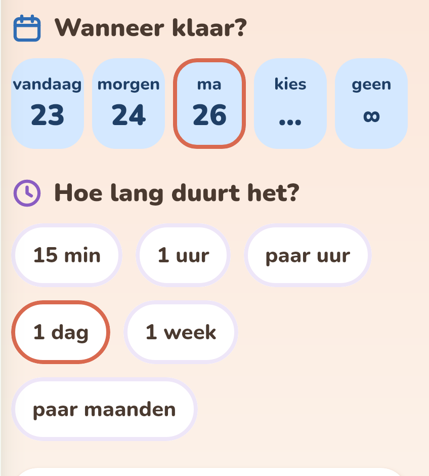

🔍 **Getest**
- ✅ Echte Android-app gebouwd (versie 0.6, dezelfde sleutel).
- ✅ 53 tests slagen. Nieuw: tips op een rustige dag, tips die passen in de tijd, drukke dag zonder tips, en een update-test van 0.5 naar 0.6.
- ✅ Android-lint: 0 fouten.
- ❌ Niet op de telefoon getest.

❓ **Voor jou** (mijn keuzes, je mag ze veranderen)
- 🕑 Ik reken op **2 uur per dag** voor Onthoud-dingen. Klopt dat?
- ❔ Niet gekozen hoe lang iets duurt? Dan reken ik een **half uur**.
