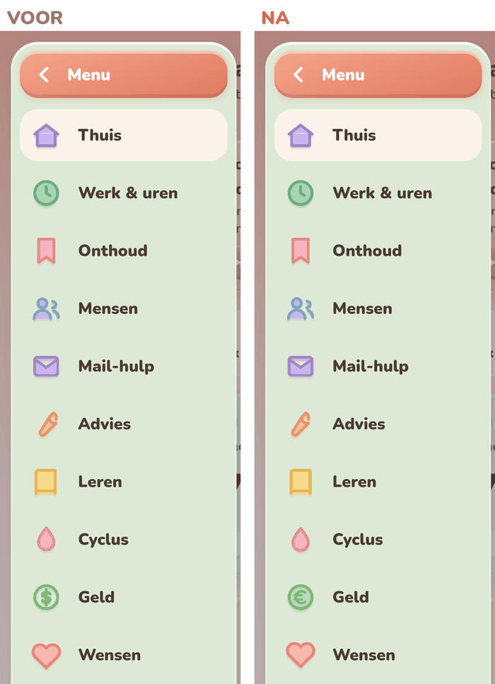
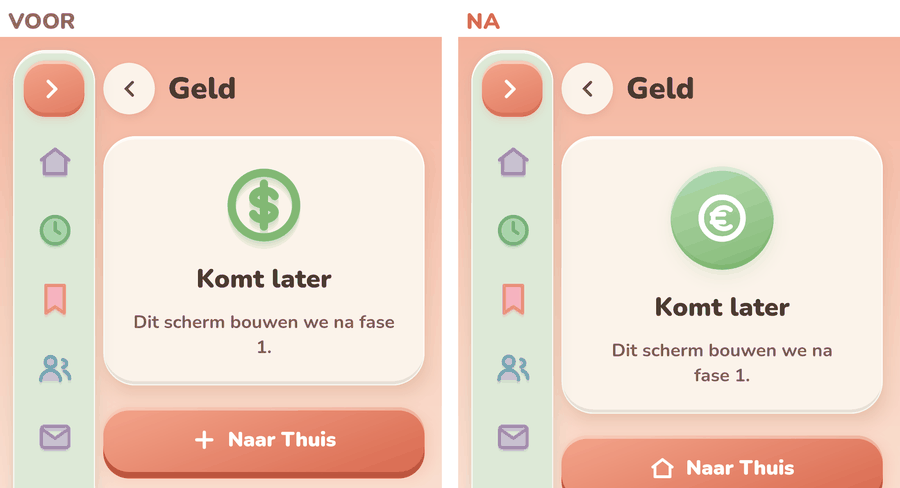
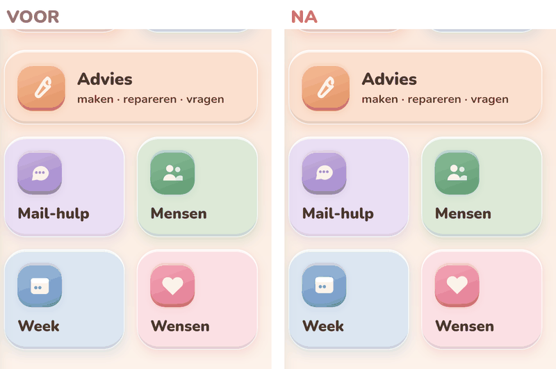
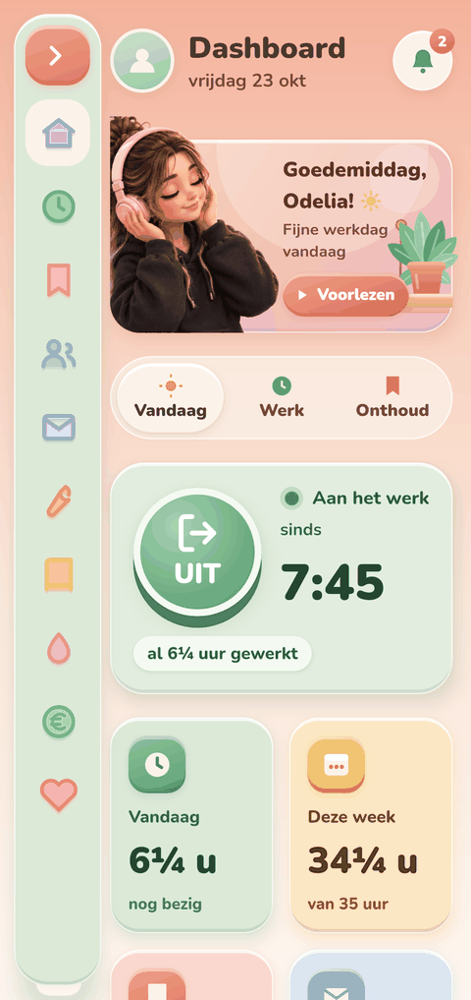
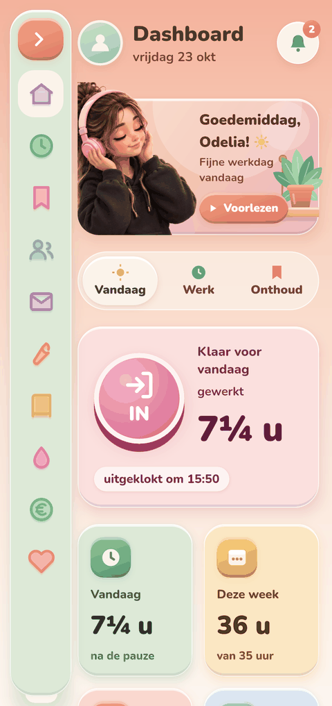
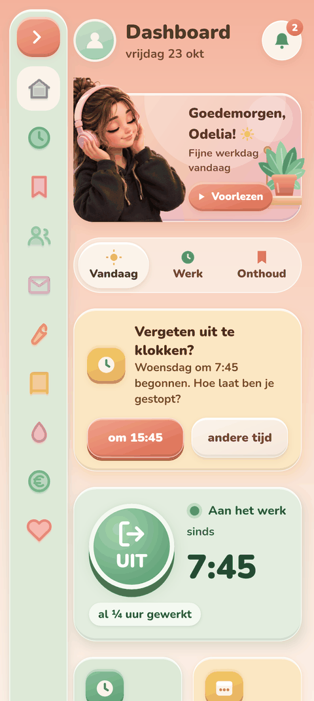
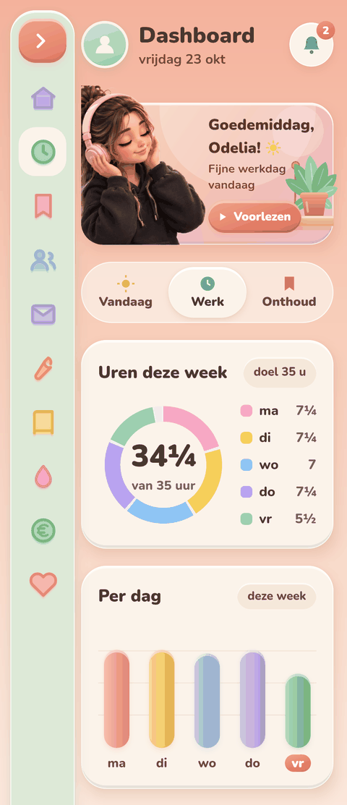
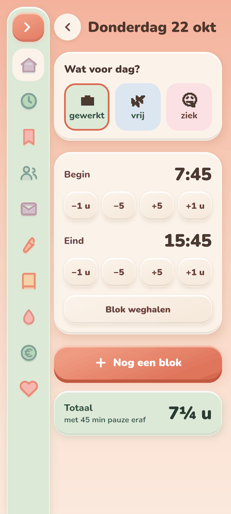

# 📒 Logboek

Wat Claude zelfstandig gebouwd heeft, per stap.
Per stap: ✅ wat klaar is · 🖼️ plaatjes · 🔍 wat getest is (en wat niet) · ❓ vragen en keuzes voor Odelia.

De plaatjes staan in de map `logboek/`. Ze komen uit het voorproef-hulpje (computer-versie van de schermen), **niet** van een echte telefoon.

---

## 0. Feedback op stap 1 (24 okt)

✅ **Klaar**
- 📋 Zijbalk: tik op een icoontje = meteen erheen. Alleen het oranje knopje maakt hem breed.
- ✨ Tik-effect: geen vlek meer. Knop wordt heel even iets kleiner.
- 🎨 Icoontjes: Geld = munt met €. "Komt later" = rond klei-knopje. 9 scheve icoontjes rechtgezet.
- 🗑️ Wachtwoorden weg.

🔍 **Getest**
- ✅ Compileert (voorproef met Compose 1.7.3).
- ✅ **Echte Android-app gebouwd in de cloud** (`app-debug.apk`). Dat lukte nu voor het eerst: `dl.google.com` werkt sinds vandaag.
- ❌ Niet op een telefoon getest. Een emulator kan hier niet draaien.

❓ **Voor jou**
- Niets.

🖼️ **Plaatjes** (links voor, rechts na)

---

## 2. ⏱️ In- en uitklokken

### 2a + 2b: echt klokken, overzicht, dag aanpassen

✅ **Klaar**
- 💾 De knop bewaart nu echt. Opslag met Room, alleen op de telefoon. Elke regel heeft een UUID en `updated_at` (klaar voor later synchroniseren).
- 🟢 Groen = aan het werk: "sinds 7:45" en "al 5½ uur gewerkt" (loopt mee, elke 30 sec).
- 🌸 Roze = klaar: "Klaar voor vandaag", uren na de pauze, "uitgeklokt om 15:50".
- 🧮 Pauze: altijd 45 min eraf (nooit onder 0). Twee keer klokken op één dag mag; de pauze gaat er maar één keer af.
- 📊 Tegels Vandaag/Deze week en het Werk-tabje (ring + staafjes) tonen echte uren.
- ✏️ Tik op een dag (tegel, legenda of staafje) → dag aanpassen:
  - 💼 gewerkt / 🌿 vrij / 🤒 ziek
  - begin- en eindtijd met knoppen −1 u, −5, +5, +1 u
  - "Nog een blok" en "Blok weghalen" (twee keer tikken, zodat het niet per ongeluk gaat)
- ⏰ Vergeten uit te klokken? Dan verschijnt een geel kaartje met de knop "om 15:45" of "andere tijd".
- 🎯 Weekdoel: tik op "doel 35 u" in het Werk-tabje en pas het aan met − en +.

🖼️ **Plaatjes**

| Aan het werk | Klaar | Vergeten |
|---|---|---|
|  |  |  |

| Werk-tabje | Dag aanpassen |
|---|---|
|  |  |

🔍 **Getest**
- ✅ Echte Android-app gebouwd.
- ✅ 9 tests voor de urenberekening (pauze, twee blokken, vrij/ziek, vergeten, weekend) slagen.
- ✅ Plaatjes bekeken en vergeleken met het ontwerp.
- ❌ Niet op de telefoon getest: opslaan, de klok die meeloopt en het knoppen-gevoel.
- ⚠️ Emoji (💼 🌿 🤒) zien er op de plaatjes zwart-wit uit. Op de telefoon zijn ze in kleur.

❓ **Keuzes die ik gemaakt heb** (zeg het als je het anders wilt)
- 🔢 Tijdens het werk: "Vandaag" = tijd sinds inklokken (zoals in het ontwerp). Na het uitklokken: uren mét de pauze eraf.
- 🌿 Vrije en zieke dagen tellen als 0 uur. Ze tellen niet mee voor je 35 uur. **Klopt dat?**
- ⏰ Bij "vergeten uit te klokken" stelt de app 15:45 voor.
